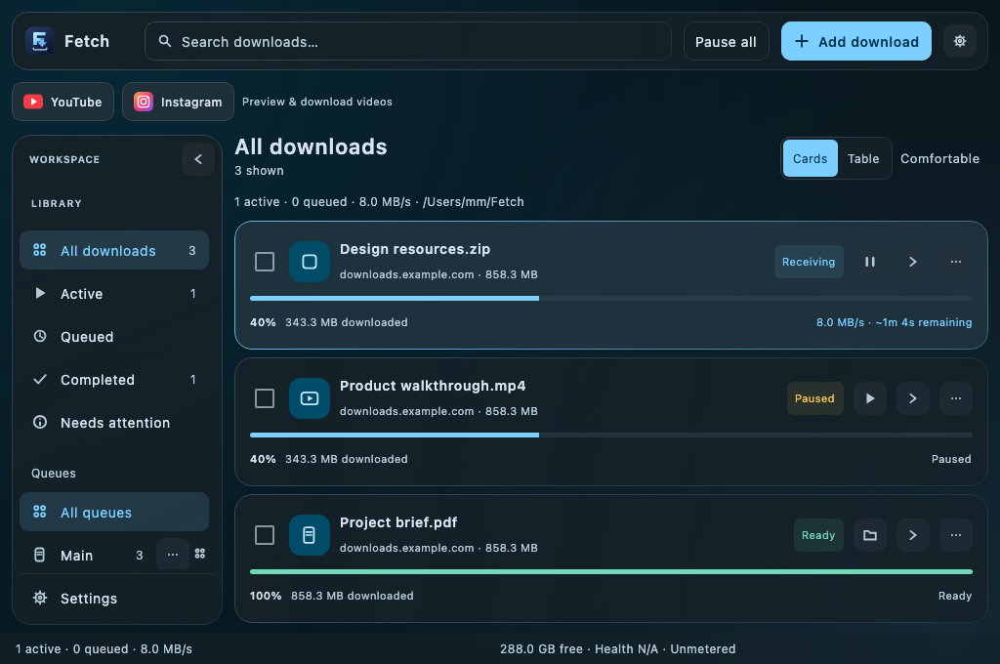
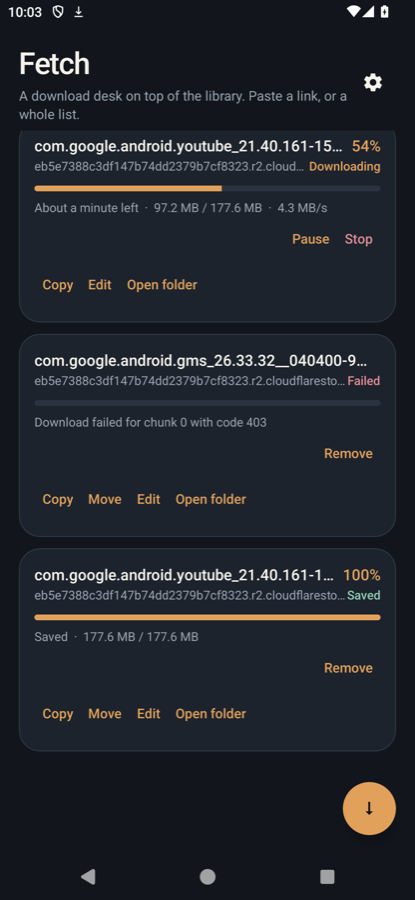
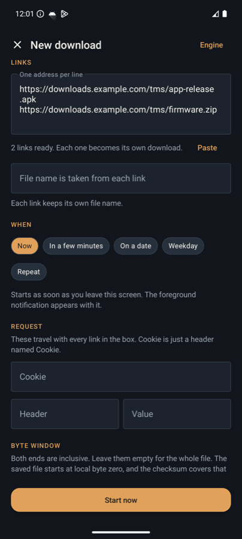
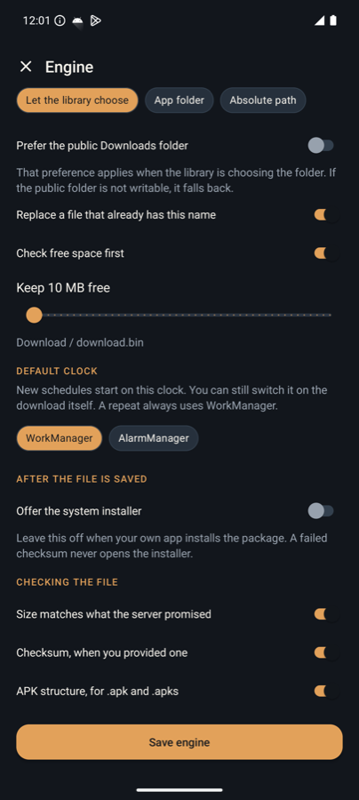

# Fetch

**Editions:** [KMP Desktop](multiplatform/desktopApp/README.md) · [Desktop website & downloads](https://mirajabi.github.io/MobileDownloadManeger/desktop/) · [Android SDK documentation](https://mirajabi.github.io/MobileDownloadManeger/)

[](https://www.jitpack.io/#mirajabi/MobileDownloadManeger)
[](docs/01-configuration.md)
[](https://github.com/mirajabi/MobileDownloadManeger/releases/tag/v1.3.7)

**Fetch** is the download desk. This repository contains the Android SDK/app and an independent **Kotlin Multiplatform desktop app**.

## Fetch Desktop · KMP

A compact Compose workspace with six Material palettes, frosted panels, a resizable/collapsible sidebar, resumable downloads and YouTube/Instagram Media Studio. Desktop releases use separate `desktop-v…` tags.

[](https://mirajabi.github.io/MobileDownloadManeger/desktop/)

[Desktop README](multiplatform/desktopApp/README.md) · [Explore themes & macOS screenshots](https://mirajabi.github.io/MobileDownloadManeger/desktop/) · [macOS release](https://github.com/mirajabi/MobileDownloadManeger/releases/tag/desktop-v1.0.0) · [Windows/Linux build workflow](.github/workflows/desktop-installers.yml)

*The image shows actual desktop UI components with sample download data. The macOS release is Apple Silicon; Windows/Linux are configured build targets.*

## Android SDK & app

**Mobile Download Manager** is the Android SDK underneath the Android Fetch app.

Fetch keeps the screen: paste a link or a list, pick a time, and watch the queue. The SDK moves the bytes. Your app still extracts the archive and installs the package. The current release is `v1.3.7`.

<p align="center">
  
  
  
</p>

## What you can do

- Download a large file in parallel ranges, then pause, resume, or stop it.
- Keep a foreground notification with progress, and a schedule that survives process death.
- Check the saved bytes: size, checksum, APK structure.
- In Fetch, copy, move, or rename a finished file, offer a copied link, and pin a home-screen widget.

## First implementation

Add JitPack, then depend on the tag. That is the whole first step. Configuration, storage, enqueue, and the rest of the SDK are in the guides below.

Kotlin:

```kotlin
repositories {
    maven("https://jitpack.io")
}

dependencies {
    implementation("com.github.mirajabi:MobileDownloadManeger:v1.3.7")
}
```

Java:

```groovy
repositories {
    maven { url 'https://jitpack.io' }
}

dependencies {
    implementation 'com.github.mirajabi:MobileDownloadManeger:v1.3.7'
}
```

## Pick a guide

Each path opens in two forms. The guideline is the designed page, with chapters, colored code, and a Kotlin / Java switch. The Markdown files are the same material, if you would rather read them in the repository.

| | Guideline | Markdown |
|---|---|---|
| **Install** · dependency, one-time setup, storage | [Open the install guide](https://mirajabi.github.io/MobileDownloadManeger/#ch-setup) | [Setup](docs/01-configuration.md) · [Storage](docs/02-storage.md) |
| **The app** · Fetch, one source file at a time | [Open the Fetch guide](https://mirajabi.github.io/MobileDownloadManeger/fetch/) | [Fetch pages](docs/fetch/README.md) |
| **The SDK** · request, queue, notification, schedule, checks | [Open the SDK guide](https://mirajabi.github.io/MobileDownloadManeger/#ch-call) | [All SDK chapters](docs/README.md) |

Open a guideline in the browser. GitHub's file view only shows the HTML source.

The built library and the Fetch apk for this tag are on the [v1.3.7 release](https://github.com/mirajabi/MobileDownloadManeger/releases/tag/v1.3.7).
