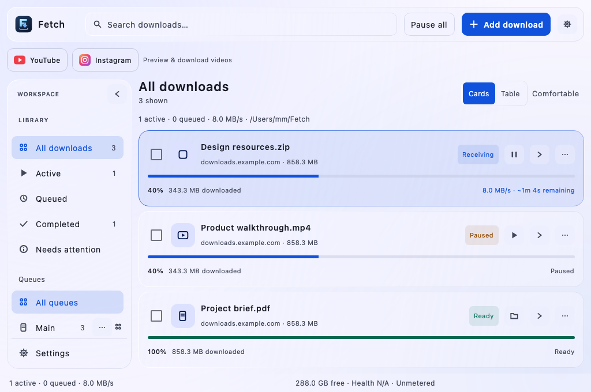
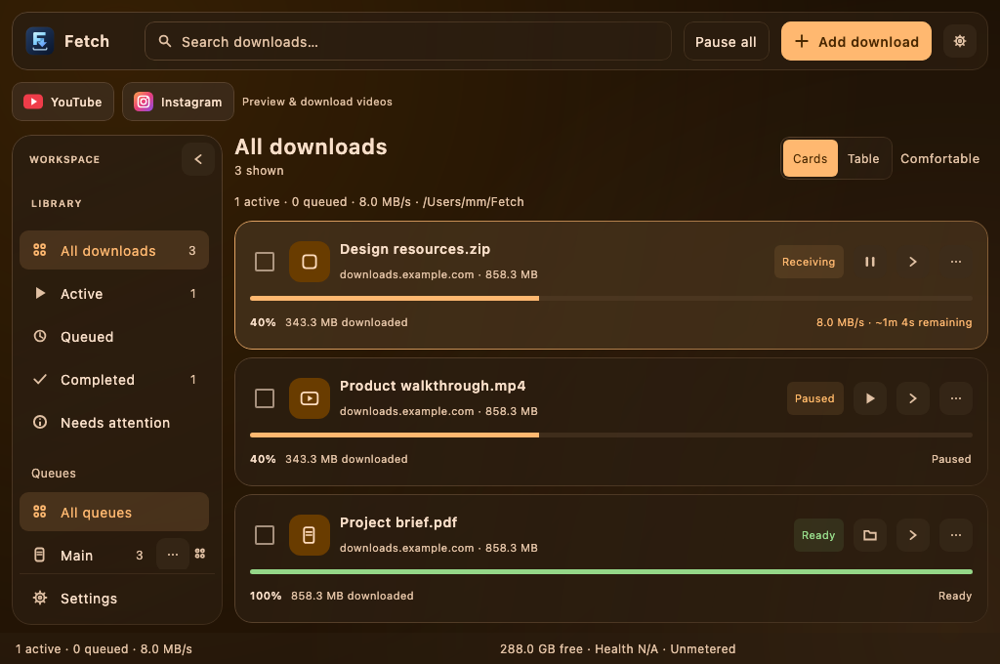
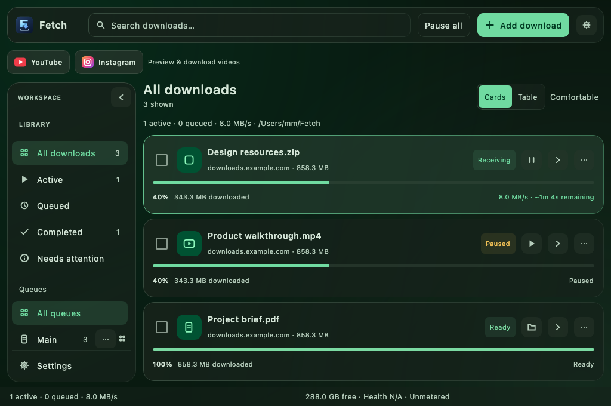
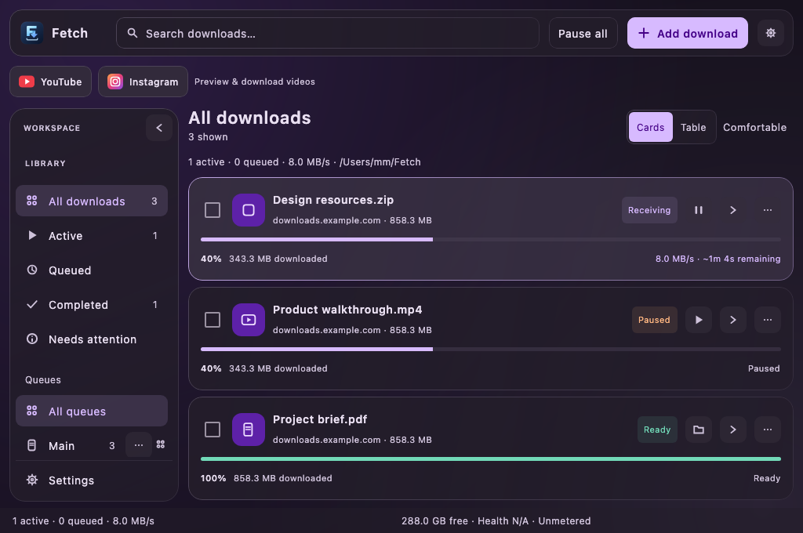
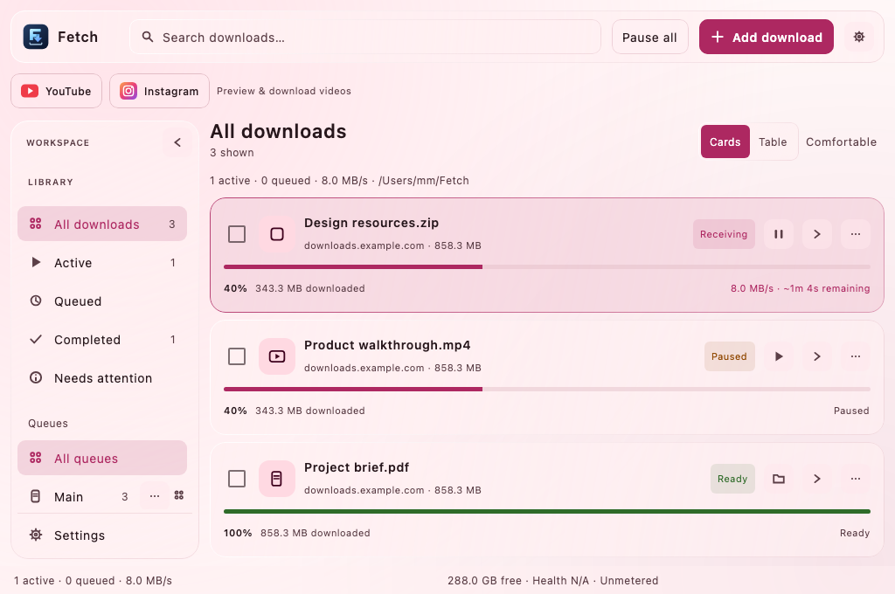
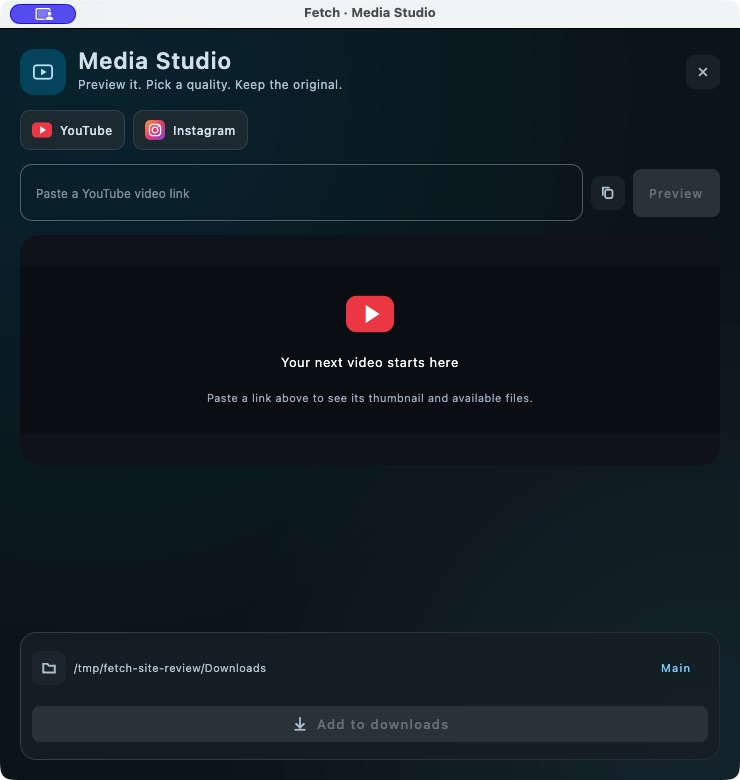

# Fetch Desktop · Kotlin Multiplatform

A compact download workspace for macOS, Windows and Linux, built with Compose Multiplatform and the shared Span transfer engine.

[Desktop website](https://mirajabi.github.io/MobileDownloadManeger/desktop/) · [macOS release](https://github.com/mirajabi/MobileDownloadManeger/releases/tag/desktop-v1.0.0) · [Installer workflow](https://github.com/mirajabi/MobileDownloadManeger/actions/workflows/desktop-installers.yml)


*Actual Compose components rendered on macOS with sample download data. Native application captures are on the [desktop website](https://mirajabi.github.io/MobileDownloadManeger/desktop/#gallery).*

## The desktop experience

- **Six Material HCT palettes:** Cobalt, Tidal, Amber, Forest, Orchid and Rose, each with its own tonal surfaces and accents. Translucent panels and a diffuse internal backdrop create the frosted appearance.
- **A compact, flexible workspace:** starts at 1040 × 680 logical pixels, remembers its size and adapts to smaller windows. Drag the sidebar between 184 and 280 dp, or collapse it to an animated icon rail. Navigation remains scrollable without a visible scrollbar.
- **Clear download controls:** cards and table rows, inline expansion, progress/speed/remaining time, selection and rounded context menus at the pointer.
- **A considered add dialog:** URL inspection, editable filename, destination, queue and advanced settings. Changing the input invalidates an earlier successful check.
- **Resumable transfers:** range downloads, checkpoints, checksums and queues. Pause drains file writers before a resumed job can begin.
- **A useful tray:** add/paste/batch, pause all, resume eligible downloads, retry failures, recent files, destination, clipboard monitoring and window controls.
- **Vector artwork:** an SVG application mark with Retina macOS and multi-size Windows icons.

| Cobalt | Tidal | Amber |
| --- | --- | --- |
|  |  |  |
| **Forest** | **Orchid** | **Rose** |
|  |  |  |

## Media Studio

The YouTube and Instagram buttons open a dedicated resizable window. Paste a video link to retrieve its title, thumbnail and available direct files. Preview compatible media inline, seek, adjust volume, choose a quality and add it to a queue.

When a source provides separate MP4 video and M4A audio, Fetch offers paired choices. The player synchronizes both tracks; the download engine resumes each track independently, and FFmpeg joins them without re-encoding. Paused work remains in a `.span-media` directory until the completed file is published. Source-page and format identifiers persist so expired addresses can be refreshed.

Extraction uses bundled **yt-dlp and Deno**. It does not import browser cookies, user extractor configuration or plugins. Private, audience-restricted, deleted and sign-in-required content may be unavailable. DRM and segmented-only streams are excluded. Inline preview depends on codec support; H.264 MP4 is preferred. These source restrictions can affect a valid Instagram link.



## Install

Desktop releases have their own `desktop-v…` tags. The repository's `v1.3.7` release belongs to the older Android SDK/app.

| Platform | Package | Current release status |
| --- | --- | --- |
| macOS Apple Silicon | [DMG](https://github.com/mirajabi/MobileDownloadManeger/releases/download/desktop-v1.0.0/Fetch-1.0.0-macos-arm64.dmg) | Built and launched on Apple Silicon; unsigned and not notarized |
| macOS Intel | DMG | Build on an Intel Mac; no Intel binary in this release |
| Windows x64 | MSI / EXE | Packaging configured; build on Windows or use the workflow |
| Linux | DEB | Packaging configured; build on Linux or use the workflow (Ubuntu x64) |

Open the macOS DMG and drag Fetch to Applications. Review the release notes and SHA-256 checksum before installing. Each package includes a Java runtime, native UI libraries, media tools and their license notices. Java does not need to be installed separately to run a package. Signing and notarization are not configured.

## Build and run

Use the **independent wrapper under `multiplatform/`**, not the repository-root Android wrapper.

Prerequisites: Git, JDK **17** (Temurin or Corretto for packaging), Python **3.10+**, and an Android SDK because the shared Gradle build also configures Android targets. Set `ANDROID_HOME` or `sdk.dir` in an untracked `multiplatform/local.properties`. Dependencies and media helpers need network access on the first run. Android compile SDK is specified in the Android modules.

```sh
git clone https://github.com/mirajabi/MobileDownloadManeger.git
cd MobileDownloadManeger/multiplatform

# Fetch pinned, checksum-verified media tools for this OS/architecture.
python3 tools/media/prepare.py

./gradlew :engine:jvmTest :desktopApp:jvmTest
./gradlew :desktopApp:run
```

On Windows, use `python` and `gradlew.bat` in PowerShell. Linux desktop testing needs a display (or Xvfb), GTK and ALSA libraries. Platform codecs may also affect JavaFX preview. Native installers must be built on their target OS and architecture; macOS cannot directly produce a Windows MSI or Linux DEB. See [Compose native distributions](https://kotlinlang.org/docs/multiplatform/compose-native-distribution.html).

```sh
python3 tools/media/prepare.py
./gradlew :desktopApp:packageDistributionForCurrentOS
```

Packages appear under `desktopApp/build/compose/binaries/main/` in `dmg/`, `msi/`, `exe/` or `deb/`. Missing media helpers fail the package task instead of producing an incomplete app. Use a full packaging-compatible JDK; the Compose packaging check rejects Homebrew's dependent JDK bundle on macOS.

The manually triggered [Fetch desktop installers workflow](../../.github/workflows/desktop-installers.yml) runs tests and packages on macOS, Windows and Ubuntu. It uploads Actions artifacts; it does not automatically publish a release. Windows/Linux artifacts still require platform validation before release.

## Source map

| Area | Location |
| --- | --- |
| Desktop shell, cards and dialogs | [`src/jvmMain/kotlin/com/miaadrajabi/span/`](src/jvmMain/kotlin/com/miaadrajabi/span/) |
| Shared transfer engine | [`../engine/`](../engine/) |
| Desktop tests and screenshot fixtures | [`src/jvmTest/`](src/jvmTest/) |
| Media helpers and SHA-256 manifest | [`../tools/media/`](../tools/media/) |
| Material palette and icon generation | [`../tools/design/`](../tools/design/) |
| Static GitHub Pages site | [`../../docs/desktop/`](../../docs/desktop/) |

Desktop downloads default to `~/Fetch`. Preferences and history are stored in `~/Span`. **View → Reset window size** restores the compact default. Themes are under **Settings → Appearance**.

## Verification

Engine and desktop JVM tests cover pause/resume byte integrity, concurrent cancellation, media parsing, loopback transport, palette contrast, sidebar resizing/collapse, inline expansion, context menus and stale URL checks. UI captures are written to `desktopApp/build/ui-review/`.

Optional `PlaybackSmokeTest` cases accept test-JVM properties `fetch.player.sample` (local MP4) and `fetch.youtube.sample` (fresh extractor JSON). They skip without fixtures; regular tests do not depend on external video services. On macOS, the native player play/pause/seek test and paused paired-download/merge test were also run with a local MP4. See the [verification record](../docs/verification.md) for scope and limitations.

## Android and iOS

The shared build already contains an Android app and an iOS shell. Desktop Compose/AWT/JavaFX screens do **not** turn into an Android APK automatically. A polished Android version needs mobile layouts, native media playback, foreground download handling, notifications, storage integration and signing. The transfer engine can be shared. See the [multiplatform overview](../README.md) and the separate [Android SDK guide](https://mirajabi.github.io/MobileDownloadManeger/).

## Bundled tools

Helper downloads are pinned and SHA-256 verified by [`prepare.py`](../tools/media/prepare.py). Installers include the corresponding license notices and `SOURCES.txt` beside the tools. Review those licenses when redistributing the application. Upstream projects: [yt-dlp](https://github.com/yt-dlp/yt-dlp), [Deno](https://github.com/denoland/deno), [FFmpeg binary distribution](https://github.com/eugeneware/ffmpeg-static), and [Material Color Utilities](https://github.com/material-foundation/material-color-utilities).
